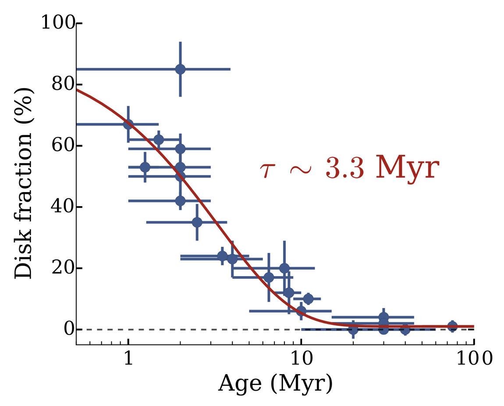

Research
{:.eyebrow}

# Protoplanetary disks and planet formation

Planets form in the disks of gas and dust that surround young stars. Their structure — where the material sits, how large the dust grains are, where gaps open up — reflects the physical processes at work. I study these disks across a range of wavelengths and compare the observations with physical models to understand how they evolve and how they form planets.
{:.lead}

A few of the main topics I work on are summarised below. They share a common approach: extracting physical insight from observations, whether for one disk imaged in detail or a large sample at once.

## Planet formation and disk substructures {#planet-formation}

<figure class="figure right">
  
  <figcaption>ALMA continuum images of MP&nbsp;Mus at 3&nbsp;mm and 1.3&nbsp;mm. A ring and inner cavity (marked) stand out at the longer wavelength, where the disk is more transparent. From Ribas et&nbsp;al. 2025.</figcaption>
</figure>

Planets that are still forming are rarely observed directly, but they leave imprints on their disks. In [Ribas et al. 2025 (*Nature Astronomy*)](https://www.nature.com/articles/s41550-025-02576-w) we studied MP&nbsp;Mus, a disk previously thought to be smooth and featureless. New ALMA observations at longer wavelengths, where the disk becomes more transparent, revealed a previously hidden inner cavity and a ring — and, combined with a subtle wobble in the star's motion measured by Gaia, narrowed the culprit down to a young gas giant orbiting close in. The broader message is that substructures may be more common than we thought, often hidden under optically thick emission. In [Ribas et al. 2023](https://ui.adsabs.harvard.edu/abs/2023A%26A...673A..77R/abstract) I had mapped the same disk down to 4&nbsp;au scales — the groundwork for that result.

<figure class="figure left">
  
  <figcaption>The RY&nbsp;Tau disk seen with ALMA (left) and a disk-plus-wall model (right): the bright arc is reproduced by the directly illuminated inner wall of the cavity. From Ribas et&nbsp;al. 2024.</figcaption>
</figure>

Not every bright feature is a gap or a trapped clump of dust, though. In [Ribas et al. 2024](https://ui.adsabs.harvard.edu/abs/2024MNRAS.532.1752R/abstract) I looked at the crescent-shaped asymmetries seen in many disks and asked whether they trace dust caught in a giant vortex or simply the bright, directly illuminated inner wall of a cavity — two very different physical pictures that can look alike at modest resolution. Modelling the wall explicitly, as in the disk around RY&nbsp;Tau, helps to tell them apart.

## Machine learning and statistical methods {#machine-learning}

<figure class="figure right">
  
  <figcaption>The neural network behind Ribas et&nbsp;al. 2020: stellar, disk, and dust parameters in, a full model spectrum out — fast enough to fit large samples. From Ribas et&nbsp;al. 2020.</figcaption>
</figure>

Fitting a physical disk model to data is slow: a single radiative-transfer model can take minutes to compute, and inferring a disk's properties needs thousands of them — which does not scale to the large samples we now have. In [Ribas et al. 2020](https://ui.adsabs.harvard.edu/abs/2020A%26A...642A.171R/abstract) (an *A&A* Highlight) I trained artificial neural networks to emulate those models, turning a minutes-long calculation into a fraction of a second. That made it possible to fit disk spectra for large samples within a Bayesian framework, and to revisit — and revise — how disk masses are estimated. The same emulator has since been used in other disk studies (for example Rilinger et al. 2023, Xin et al. 2023, and Zamudio-Ruvalcaba et al. 2025).

Recurring methods in this work: neural-network surrogates for computationally expensive models, Bayesian inference applied to large samples, and treating heterogeneous archival data as a single, carefully calibrated dataset rather than a collection of separate catalogues.

Related work includes statistical methods to detect rings in disks that are not spatially resolved (Scardoni et al. 2024) and Gaia-based studies of young stellar populations (Delfini et al. 2025). Working at ALMA for four years, where I also handled data quality assurance and calibration, made clear how much of the science depends on the pipeline that produces the data in the first place.

## The evolution of protoplanetary disks {#evolution}

<figure class="figure right">
  
  <figcaption>Disk fraction as a function of age across nearby star-forming regions; the fraction falls to near zero within ~10&nbsp;Myr (characteristic timescale τ&nbsp;≈&nbsp;3.3&nbsp;Myr). From Ribas et&nbsp;al. 2014.</figcaption>
</figure>

Disks live for millions of years, so we cannot watch a single one evolve. Instead we compare populations of different ages. The difficulty is that samples assembled from many separate studies are heterogeneous, and that inhomogeneity can masquerade as real evolution. In [Ribas et al. 2014](https://ui.adsabs.harvard.edu/abs/2014A%26A...561A..54R/abstract) we built a large, uniformly analysed sample of young stars across 22 nearby regions, from the optical to the mid-infrared, and confirmed that disks disperse within ~10&nbsp;Myr, with signs of inside-out clearing.

<figure class="figure left">
  
  <figcaption>Disk dispersal as a function of stellar mass and age. From Ribas et&nbsp;al. 2015.</figcaption>
</figure>

That same sample let us ask whether stellar mass matters. It does: disks around more massive stars disperse faster ([Ribas et al. 2015](https://ui.adsabs.harvard.edu/abs/2015A%26A...576A..52R/abstract)), which could leave planets around high- and low-mass stars looking rather different. Extending the sample to millimetre wavelengths, we later found that dust grains have already begun to grow — the first step toward planets — in most disks by an age of just ~1&nbsp;Myr ([Ribas et al. 2017](https://ui.adsabs.harvard.edu/abs/2017ApJ...849...63R/abstract)).

## Disks in multiple systems {#circumbinary}

<figure class="figure left">
  
  <figcaption>The disk around HD&nbsp;98800B (left) and our model (right); a gap ~3&nbsp;au wide has been carved by the central binary. From Ribas et&nbsp;al. 2018.</figcaption>
</figure>

Many stars form in pairs or in larger multiple systems, where a stellar companion can strongly perturb a disk and disperse it before planets have time to form. Even so, some disks in multiple systems are surprisingly long-lived. HD&nbsp;98800 is a good example: four stars arranged as two binaries orbiting one another, where one of the pairs still retains its disk at an age of ~10&nbsp;million years.

In [Ribas et al. 2018](https://ui.adsabs.harvard.edu/abs/2018ApJ...865...77R/abstract) we used the VLA to resolve this disk for the first time and found it far more compact than expected — only ~5&nbsp;au across — with a central gap ~3&nbsp;au wide carved by the binary. More recently, in [Ribas et al. 2026](https://doi.org/10.1093/mnras/stag641) we found evidence for large dust grains and a possible dust trap in its unusual *polar* ring, one of the few places where grain growth can be watched in such an extreme configuration. I have studied related circumbinary and multiple systems too, including V892&nbsp;Tau and the TWA&nbsp;3 triple.

## Transitional and debris disks {#transitional-debris}

<figure class="figure right">
  
  <figcaption>The Chamaeleon&nbsp;I star-forming region seen by the Herschel Space Observatory. From Ribas et&nbsp;al. 2013.</figcaption>
</figure>

Earlier in my career I worked on *transitional* disks — disks with large inner holes and gaps that can be signposts of forming planets. Using the Herschel Space Observatory to probe their cold outer regions, I showed how far-infrared data can pin down their structure and mass ([Ribas et al. 2013](https://ui.adsabs.harvard.edu/abs/2013A%26A...552A.115R/abstract), [2016](https://ui.adsabs.harvard.edu/abs/2016MNRAS.458.1029R/abstract)).

I am also interested in what comes next: *debris* disks, the dusty remnants of planet formation. In [Ribas et al. 2012](https://ui.adsabs.harvard.edu/abs/2012A%26A...541A..38R/abstract) I searched for warm debris around stars with transiting planets, where collisions in an inner asteroid belt — possibly stirred by the planets themselves — could produce detectable dust. More recently I have been involved in resolving the large exo-Kuiper belt of HD&nbsp;126062 with ALMA (Miley et al. 2025) and in detecting gas in the debris disk of HD&nbsp;36546 (Rebollido et al. 2022).

A full, up-to-date list is on my [publications page](publications.html) and on [NASA ADS](https://ui.adsabs.harvard.edu/search/q=orcid%3A0000-0003-3133-3580&sort=date%20desc).
{:.small .muted}
